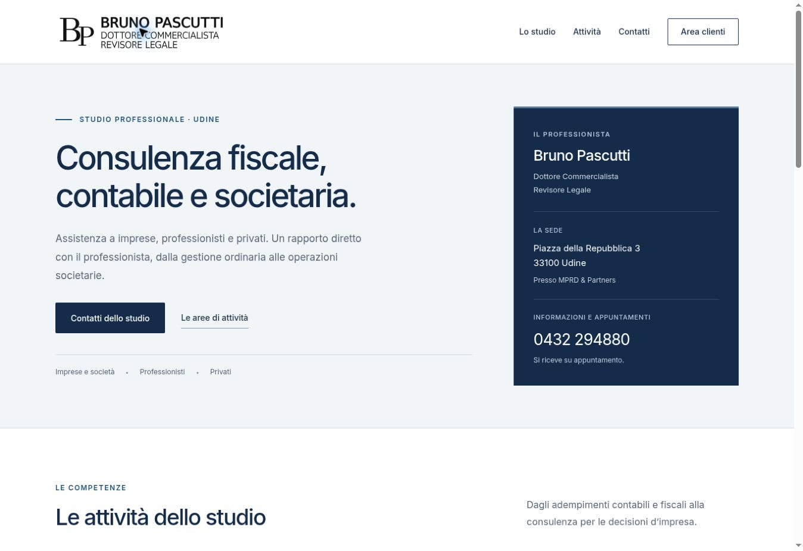

# Studio Pascutti — seconda proposta grafica

Revisione del 24 novembre 2026, successiva alle osservazioni di Bruno su logo, fotografia e veste professionale.

## Identità

È stato recuperato il file originale `targa_bruno_pascutti_v5_tracciati.svg`, versione della targa del 20 agosto 2026. La fonte completa è conservata senza modifiche in `assets/brand/targa-originale-v5.svg`.

- Monogramma BP, nome e qualifiche provengono dai tracciati originali: nessun carattere o segno ricostruito.
- La firma nell’intestazione è una composizione orizzontale per il web: monogramma a sinistra, nome e qualifiche a destra, nero originale. Sono state cambiate solo disposizione e dimensione uniforme dei gruppi.
- La sezione dello studio riprende la composizione completa della targa, con solo ritaglio dei margini esterni.
- Il monogramma autentico è utilizzato anche nella favicon.
- I dettagli di provenienza e degli adattamenti sono in `assets/brand/README.md`.

## Impostazione grafica

Blu inchiostro #142c49, blu #24557d, bianco e grigio freddo #f2f5f8. Eliminati salvia, ottone e fondo avorio. Il marchio mantiene il proprio nero.

La fotografia di Udine è stata rimossa. L’apertura presenta direttamente consulenza fiscale, contabile e societaria, con recapiti e sede in evidenza. Tipografia Inter, titoli misurati, sei attività ordinate con separatori sottili. Profilo, area clienti e contatti seguono la stessa gerarchia. Aggiornata anche la pagina servizi online.

## Verifiche

- Esame visivo completo di homepage e servizi nel browser.
- Layout mobile in contenitori da 360 px per la home e 320 px per i servizi: nessuno scorrimento orizzontale, anche con testo ingrandito nei servizi.
- Menu mobile: apertura e chiusura con Escape verificate.
- Collegamento dalla home alla sezione documenti: sezione aperta e visibile sotto l’intestazione.
- File e ancore locali presenti, ID univoci, una H1 per pagina, sintassi JavaScript e `git diff --check` verificati.
- Fonte del logo byte-identica; dati dei tracciati confrontati con l’originale.

## Prima del lancio definitivo

Confermare l’indirizzo e-mail ordinario; fornire il collegamento OneClick e l’eventuale sistema di prenotazione; completare guide, circolari, modulistica e informative. I servizi non ancora collegati sono indicati come in preparazione, con contatto telefonico disponibile.

Il noindex resta presente, come richiesto dal README originario. Questa proposta è conservata sul ramo locale `design/proposta-grafica-2026`. La scrittura nel repository GitHub era stata rifiutata dai permessi dell’integrazione; nessuna modifica è stata applicata al ramo main o al sito GitHub Pages esistente.

## Anteprime

[Pagina intera](anteprima-pagina-intera.jpg)

## Anteprima navigabile

https://studio-pascutti-anteprima.studio-bruno-5185.chatgpt.site

Anteprima privata accessibile al proprietario tramite ChatGPT.
